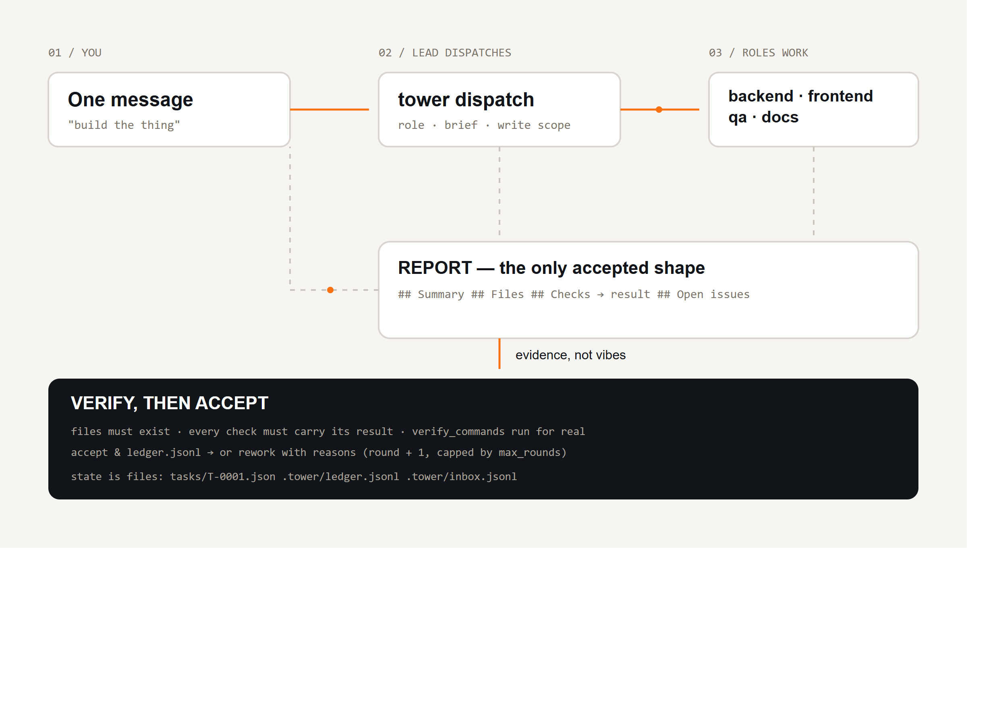
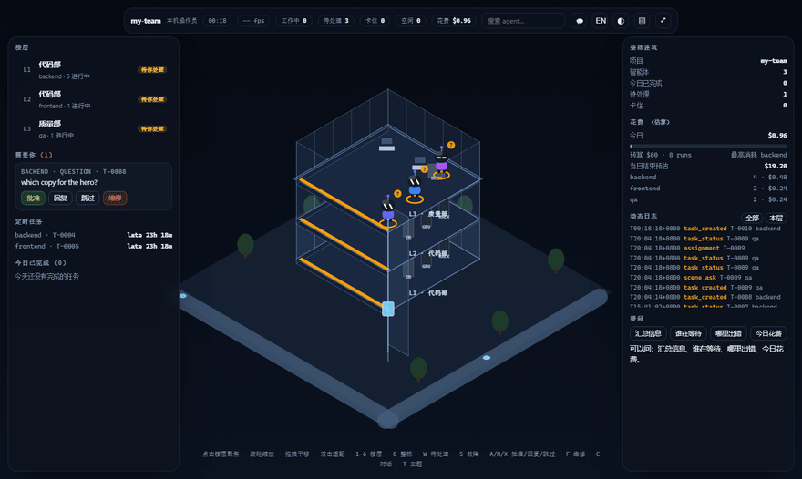
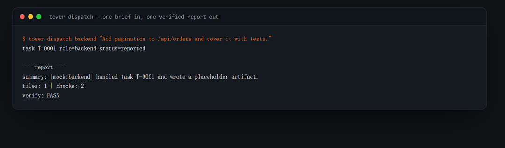
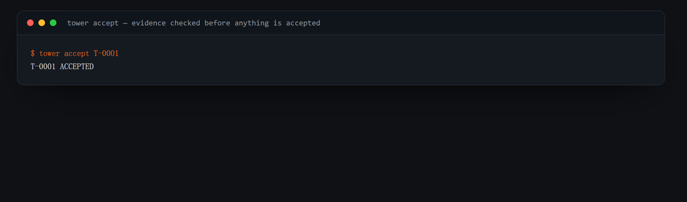
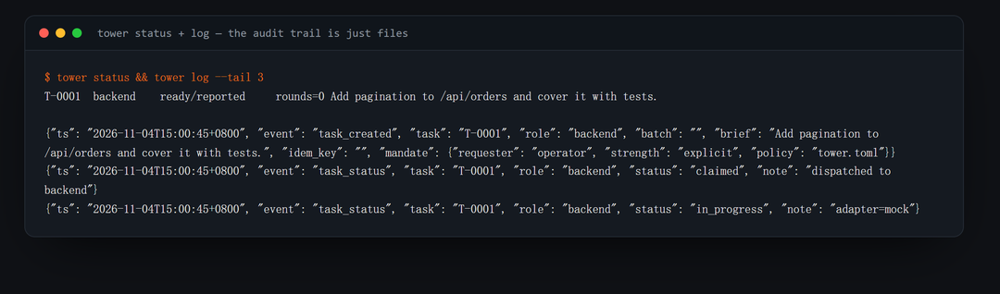
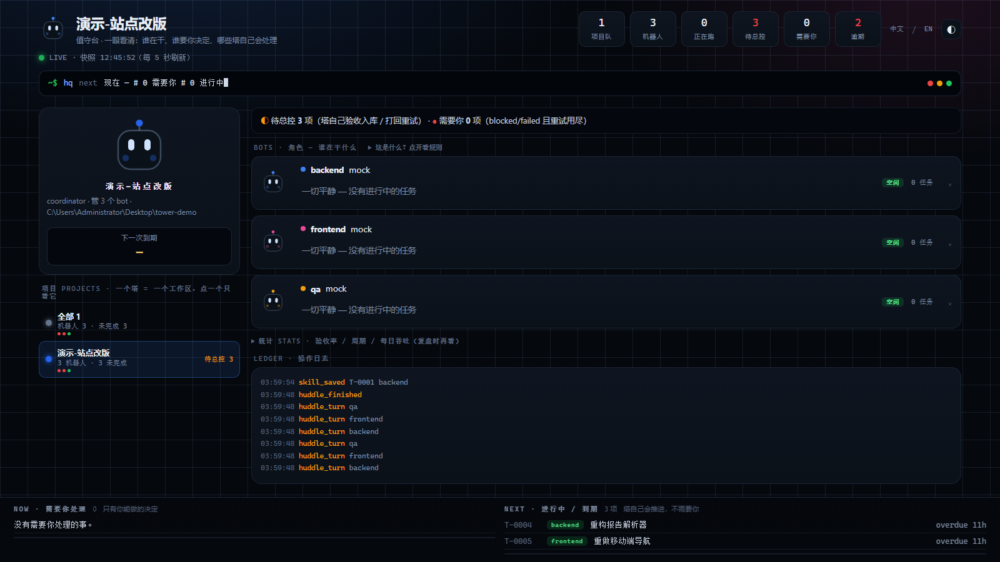

<div align="center">

# agent-control-tower

**One agent to talk to. Many agents doing the work. Evidence before "done".**

A local control tower for role-based AI agent teams — dispatch, report, verify, accept or rework.
DSH-first, adapter-portable, no SaaS, no database, no daemon.

[](README.md) [](README.zh.md)

[](pyproject.toml)
[](LICENSE)
[](tests)
[](https://github.com/evolution301/agent-control-tower/actions/workflows/ci.yml)
[](https://github.com/evolution301/agent-control-tower/releases)
[](pyproject.toml)
[](packages/dsh-tower)

</div>



## The problem

You can already get one agent to write code, one to write copy, one to review. What breaks is **the handoff between them** — in five predictable ways:

| What actually happens | What it costs you |
|---|---|
| **Self-grading** — the agent that did the work also reports "done, tests pass". It never ran them. | You ship a bug and find it in production. |
| **Context rot** — a long session compacts its history, and the deliverable was "in the conversation". | Re-doing work, contradicting earlier decisions, circular rounds. |
| **Silent collisions** — two agents edit the same file in the same round; both report success. | Lost work, regressions nobody can explain. |
| **No audit trail** — which role changed what, on which instruction? | You cannot review, reproduce, or hand the project over. |
| **Ping-pong** — "fix it" → "fixed" → "still broken". Nothing tracks rounds or forces escalation. | Hours burned; you become the message bus. |

`agent-control-tower` is the missing middle layer.

## The loop



<p align="center"><sub>Real output: <code>tower demo</code> → <code>tower dispatch</code> → <code>tower accept</code> → <code>tower status</code> / <code>tower log</code></sub></p>

| Dispatch | Verify &amp; accept |
|---|---|
|  |  |

| Audit trail — just files |
|---|
|  |

```bash
tower dispatch frontend "Rework the home layout. Deliver before/after screenshots at 1440 and 390."
tower inbox                      # what came back
tower accept T-0001              # files exist? checks carry results? verify_commands pass?
tower rework T-0001 --note "Checks list no results; re-run the suite"
```

## Who it is for

**Good fit**

- You already run **2–8 agent sessions** (DSH, Claude Code, Codex, Cursor, Aider, plain API) and you are the one copy-pasting between them.
- **Indie devs / small teams** building something multi-part: an app (backend + frontend + QA), a content site (research → copy → design → SEO), a data pipeline.
- **Agencies / freelancers** who must show a client *what was done and how it was verified* — the ledger and reports are that answer.
- **Anyone burned** by an agent saying "done" when it was not.
- **CI / automation** that wants reproducible agent work: `tower demo` runs the loop offline in under a second.

**Not a good fit**

- One-shot tasks ("rename this variable") — a single prompt is faster.
- You want agents to talk to each other freely — this design is deliberately hub-and-spoke.
- You want a hosted dashboard / multi-tenant service — this is a local CLI with adapters.

## What you get

| Without the tower | With the tower |
|---|---|
| You paste briefs between windows | `tower dispatch <role> "<brief>"` — contract and write scope included |
| "Done ✅", no evidence | Reports must list **Files** (must exist) and **Checks** (must carry a result); `verify_commands` run for real |
| Deliverables live in chat | Deliverables in `roles/<role>/`, reports in `<task>-REPORT.md` |
| Nobody knows who changed what | Append-only `.tower/ledger.jsonl`, timestamped |
| Rounds loop forever | `round` counter + `max_rounds` → the tower stops and tells you to escalate |
| Two agents overwrite each other | `write_scopes` per role, one directory per role |
| Work lost after compaction | State on disk; `tower rework T-0012` resumes with the note attached |
| Can't hand the project over | `git log` of reports and tasks *is* the handover doc |
| You re-read every report to see if a human is needed | `tower attention` lists only `ready` / `blocked` / `failed` |
| A retry or a double-click creates duplicate work | `tower dispatch --key <id>` returns the existing task |

## Deploy guard: never overwrite a live file that drifted

A bot edited a theme file **on the server**; the local working copy never got the
change, and the next normal upload silently erased it (2026-11-11). The tower now
carries the check that makes that impossible to do by accident:

```bash
tower deploy check generatepress-child/functions.php --remote ./functions.php
# in_sync       → nothing to upload
# local_changed → safe to upload (only local moved)
# remote_drift  → REFUSE: pull first (`tower deploy pull ...`)
```

`init` accepts the current server state as baseline, `pull` brings the server copy
into local (local file backed up under `.tower/deploy/backup/`), `done` verifies an
upload landed and advances the baseline. Every action is ledgered, a receipt is
written under `.tower/deploy/receipts/`, and `--role <role>` also appends to
`roles/<role>/DEPLOY-SYNC.md`. How the remote file is read is one config line:

```yaml
deploy:
  fetch: ["{python}", "-m", "control_tower.deploy_fetch",
          "--cwd", "<site>/generatepress-child", "--remote", "{remote}"]
```

`control_tower.deploy_fetch` imports the project's `w.py` and reads the file via
`w.sync_request({"action": "read_file", …})` — generic for w.py-based sites. Put the
protocol in `docs/deploy-rules.md` and it rides every dispatch prompt.

## Install

```bash
git clone https://github.com/evolution301/agent-control-tower.git
cd agent-control-tower
python -m venv .venv && source .venv/bin/activate   # Windows: .venv\Scripts\activate
pip install -e .
```

Python 3.10+. One runtime dependency (`PyYAML`).

## 60-second demo (no model, no network, no API key)

```bash
tower demo
```

```
[1] dispatched T-0001 -> reported
[2] verify: PASS
[3] accepted T-0001
[4] ledger lines: 5
```

The `mock` adapter writes a placeholder artifact and a real report, so the entire
dispatch → report → verify → accept loop is deterministic and CI-friendly.

## Use it with DSH (primary)

The pattern was extracted from a real [DeepSeek Harness](https://github.com/) deployment: one lead
session steering several long-lived role sessions through a multi-week build, verifying every
delivery.

```yaml
# tower.toml
roles:
  frontend:
    description: Layout, components, styling, browser verification.
    adapter: dsh
    write_scopes: ["web/"]

adapters:
  dsh:
    base_url: "http://127.0.0.1:65163"
    sessions:
      frontend: "session-acc99990-..."
```

→ Full walkthrough: **[docs/dsh-quickstart.md](docs/dsh-quickstart.md)** — create role sessions, wire
config, run the loop, plus the five failure modes the reference project hit and how the code prevents
them.

### Drive it from inside DSH: `packages/dsh-tower`

A companion bundle registers five tools on the harness tool registry, so the session never leaves the
conversation:

```bash
dsh plugin --profile <name> add ./packages/dsh-tower
```

`tower_dispatch` · `tower_inbox` · `tower_accept` · `tower_rework` · `tower_status`
→ [packages/dsh-tower](packages/dsh-tower/README.md)

## Panel: what needs me, and is this team working well

`tower panel` serves one read-only page on `127.0.0.1` (default 8787, `--port` to
move it). It answers three questions in the order a person asks them:

1. **now** — what needs you (only person-states get red), what is in flight;
2. **who** — one robot per role, its face *is* its state (blinking = idle, hopping =
   working, X eyes shaking = failed);
3. **history** — the ledger, plus a business strip: verified rate, lead time p50/p90,
   throughput, per-role numbers, overdue and nudges.

**Several projects, one switcher.** Each project keeps its own `tower.toml` and
`.tower/`; `tower projects add <path>` (or `scan`) registers them and the page grows
project pills plus an **all projects** view. `tower projects use <name>` marks the
active one — the panel defaults to it, and the DSH bundle's `tower_*` tools follow it
(`tower_use` switches it from inside a session, no restart).

Deep links: `?lang=zh`, `?theme=dark`, `?project=<name>`, `?project=__all__`.

### Async dispatch & relay (0.9.0)

`tower dispatch --async` queues the task and returns its id in under a second; a
background `tower worker` process (started automatically on first use) runs the
adapter, relays peer messages and runs auto-triage, then lands an `async_settled`
notice in `tower inbox`. Set `dispatch_mode: async` in `tower.toml` (or
`roles.<name>.dispatch_mode`) to make it the default; `--no-auto` and every other
flag behave as in sync mode.

`tower relay --to <target> -m "..."` delivers a message to **any** DSH session —
a session id, a unique session-title substring, or the alias `tower` (this
tower's own inbox). With `--await-receipt`, a worker watches for a reply carrying
the relay id (the peer answers with `tower relay --to tower --reply <id> -m
"..."`) and lands a `relay_receipt` — or `relay_timeout` — in the inbox.

In the DSH plugin this is `tower_dispatch {async: true}` and the new
`tower_relay` tool.

#### Async knobs (0.9.1)

```yaml
dispatch_mode: async      # tower default (per-role: roles.<name>.dispatch_mode)
workers: 4                # threads inside one `tower worker` process
notify:
  kind: lead_session      # inbox (default) | lead_session — one message pushed to the lead's session
  session: session-…
async_roles: [seo, ops]   # role-level override as a list
```

Relay flags: `--to role:<name>` targets a role's session; `--wait <file>` uses a
file as the receipt (its content, once it appears); `--timeout 45m` uses the same
duration grammar as `--due`. Settlement notices read
`[tower] T-00xx settled: accepted | role=… | summary=…`, land in `tower inbox`,
and — with `notify.kind: lead_session` — are also pushed to the lead's session.
`.tower/.lock` serialises board writes; `.tower/events.jsonl` is the
enqueued→settled→notified audit trail.


The **control room** lives at `/scene`: an isometric glass tower where each role is a robot,
floors are departments, LED strips show alert state, and approving / replying / repairing
happens in place (every action lands in the ledger). Data comes from `/api/scene`, i.e. from
the same task files this README describes.

`tower panel` keeps a **stable URL**: it reuses the port this workspace used last
time (`.tower/panel-port`), else 8787, else the next free port — and remembers the
choice, so a bookmarked page keeps working. Two panels can no longer share one port.
When the installed code changes (a plugin update), the running panel detects it and
**restarts itself**, and the page reloads once the new instance answers — no more
"the board is silently showing yesterday's build".

**Every number has a written formula.** The board is for people, so the model is
specified once — [docs/board-model.md](docs/board-model.md) — and the page, the CLI
and the panel all read the same decisions:

| Queue | Who owns it |
|---|---|
| 需要你 / *needs you* | a person: only `blocked` or `failed` (retries exhausted) |
| 待总控 / *tower queue* | the tower: verify → accept, or rework with the failure reasons |
| 进行中 / *in flight* | the bot |
| 已完成 / *done* | nobody: accepted tasks never occupy a queue |

`tower triage` closes that loop; `tower dispatch` runs it automatically after a
report (`--no-auto` opts out), so an accepted-by-verifier job never waits for a human.

Two renderings of the same snapshot — the terminal (`tower board`) and a local read-only web panel
(`tower panel`). Person-states first, healthy work takes no space.



```bash
tower board            # print once
tower board --watch    # refresh in place (tmux/ssh friendly)
tower panel            # http://127.0.0.1:8787/  (read-only, auto-refresh 2s)
```

The panel shows **needs you** (ready / blocked / failed, each with its one question), then what is in
flight, then what every role is doing right now, then the tail of the ledger. It reads the same files
the CLI does — no database, no daemon, no writes.

## Which tower does a command talk to?

Resolution is exactly: **`--workspace <dir>` > a `tower.toml` found by walking up
from the cwd > an error**. The CLI deliberately does **not** fall back to the
global active-project pointer (`tower projects use`): with several towers alive
that silently routed `say` / `dispatch` / `accept` into the wrong tower
(2026-11-10 field report). The pointer only steers the GUI panel.

Every write command (`dispatch`, `accept`, `rework`, `relay`, `say`, `escalate`,
`batch`, `restate`, `review`, `attention claim|resolve`) prints
`resolved workspace = <path>` on stderr first, so the caller can see the target
even when stdout is machine-readable (`--json`).

```bash
tower --workspace G:/projects/tower-a dispatch ops "deploy"
```

## Adapters

An adapter is the only component that knows how to make an agent act. Same contract for all four:

| Adapter | Drives | Use when |
|---|---|---|
| `dsh` | a live DeepSeek Harness session (`session/prompt`, queued) | **primary**: long-lived roles with browser + shell tools |
| `cli` | any agent binary that takes a prompt (`claude -p`, `codex exec`, Aider, your script) | you already run agent CLIs |
| `openai` | any OpenAI-compatible `/chat/completions` with a small `run_shell` loop | hosted models, vLLM, Ollama |
| `mock` | nothing (writes a placeholder artifact) | tests, demos, CI |

Adding one is ~40 lines → [docs/adapters.md](docs/adapters.md).

## The report contract (and why the verifier exists)

```markdown
## Status         → progress | waiting | ready | blocked | failed | dropped
## Summary        → 2–5 sentences
## Files          → - <path> — <what changed>          (must exist on disk)
## Checks         → - <command run> → <result seen>    (a bare command fails)
## Open issues    → anything unfinished, or "none"
## Attention      → only when status is blocked/failed: one concrete question
```

The status vocabulary is a closed set, borrowed from DeepSeek's
[dsh-superagent](https://github.com/deepseek-ai/dsh-superagent-prototype) research prototype: the
lead routes on a state, not on prose, and `tower attention` shows only the tasks that are actually
waiting for a person. See [docs/superagent-ideas.md](docs/superagent-ideas.md) for what we borrowed
and what we deliberately left out.

`tower accept` mechanically rejects: a missing/empty section · a check line without a result · a
listed file that does not exist · any failing entry in `verify_commands`.

```yaml
verify_commands:
  - "pytest -q"
  - "npm run build"
```

That is the difference between *"the agent said it works"* and *"the tower checked"*.

## Commands

| Command | Purpose |
|---|---|
| `tower init <dir>` | scaffold config + role folders |
| `tower dispatch <role> "<brief>" [--due 90m]` | create and run one task (idempotent with `--key`, deadline with `--due`) |
| `tower dispatch <role> "<brief>" --restate` | restatement gate: the role first says back what the brief means; no work runs |
| `tower restate ok <task>` | accept that restatement, then dispatch the work |
| `tower say <from> <to> "…"` | bot-to-bot note: queued into the peer's session + filed for the lead, fire-and-forget |
| `tower huddle role1 role2 … --topic "…"` | up to six roles, two bounded rounds; minutes land in `.tower/huddles/` |
| `tower stats [--all] [--days 14]` | business view: verified rate, lead time, throughput, per-role stats |
| `tower projects list` / `scan` / `add` / `remove` / `use` | many towers, one switcher: what the panel and `tower_*` tools follow |
| `tower supervise` | chase every open task past its deadline in its own session |
| `tower batch role1 role2 --brief "…"` | fan one brief out to several roles |
| `tower inbox [--all] [--read]` | reports filed by roles (the full log) |
| `tower attention` | **only** the tasks waiting on a person |
| `tower board [--watch]` / `tower panel` | the same picture, in a terminal or a local web page |
| `tower accept <task>` | verify, then accept (auto-rejects to rework) |
| `tower rework <task> --note "…"` | send back with reasons and re-dispatch |
| `tower status [--json]` | task board |
| `tower show <task>` / `tower log` | inspect one task / tail the ledger |
| `tower demo` | offline end-to-end demo |
| `tower doctor` | validate config, adapter options, keys, sessions |

`--restate` buys one cheap turn before an expensive one. The role answers with only
`## Restatement` / `## Assumptions` / `## Done looks like`; the task waits in `restating`, shows up under
**needs you**, and cannot be accepted — no report exists yet. `tower restate ok <task>` copies the
accepted text into the work prompt as `## Confirmed understanding`, then dispatches. The gate fails
closed: a non-zero exit or a missing section leaves the task `failed`, never `restating`.

## What's on disk

```
my-project/
├── tower.toml              # roles, adapters, verify commands
├── roles/
│   ├── backend/            # this role's only write area
│   │   ├── AGENT.md
│   │   └── T-0001-REPORT.md
│   ├── frontend/
│   └── qa/
└── .tower/
    ├── tasks/T-0001.json   # materialised task view
    ├── ledger.jsonl        # append-only event log (source of truth)
    └── inbox.jsonl         # reports + unread flag
```

## How it compares

|  | single agent | agent framework (graph/DSL) | **agent-control-tower** |
|---|---|---|---|
| Who routes the work | the one agent, in its head | the graph you wrote | the lead, explicitly, per task |
| Deliverable | chat text | node outputs | files + a four-section report |
| "Done" means | the agent said so | the node finished | the tower verified it |
| Audit trail | scrollback | framework logs | `ledger.jsonl` you can `git diff` |
| Setup | prompt | graph + runtime + infra | `pip install` + one YAML |
| Runs offline / in CI | no | sometimes | yes (`tower demo`) |

## FAQ

**Do I need DSH to use it?** No. DSH is the primary adapter because that is where the pattern came
from; `cli`, `openai` and `mock` follow the same contract.

**Does it run the agents itself?** No. It renders the prompt, calls your adapter, and checks what came
back. The agent runtime stays yours.

**Can agents talk to each other?** No. Hub-and-spoke on purpose: the lead routes, so the task tree
stays inspectable and two roles cannot silently converge on the same file.

**What if a role keeps failing?** `round` increments on every `rework`; when `round > max_rounds` the
tower stops and tells you to escalate instead of looping.

**Is the ledger safe to commit?** Yes — append-only JSONL; committing it puts the audit trail in
`git log`. Add `.tower/` to `.gitignore` if you only want deliverables.

**Where does it write?** Only inside the tower workspace: `roles/<role>/` for deliverables and
`.tower/` for state.

## Docs

| Doc | What's inside |
|---|---|
| [DSH quickstart](docs/dsh-quickstart.md) | the primary setup, end to end, plus five failure modes it prevents |
| [Architecture](docs/architecture.md) | components, state machine, why files instead of a queue |
| [Adapters](docs/adapters.md) | mock / cli / dsh / openai, and how to add your own |
| [Borrowed from dsh-superagent](docs/superagent-ideas.md) | the five ideas we adopted, and what we left out |
| [Contributing](CONTRIBUTING.md) | ground rules, PR checklist, adapter guide |

## License

MIT — see [LICENSE](LICENSE).

## Acknowledgements

- The pattern was extracted from a real long-running build on [DeepSeek Harness](https://github.com/),
  then generalised so it works without it.
- The `dsh-tower` bundle follows the harness bundle conventions from the
  [DeepSeek Harness docs](https://github.com/deepseek-ai/deepseek-harness): `dsh.bundle` +
  `cordis.patch.yml` + `ctx.tools.register`.
- Terminal frames in this README are **real command output**, rendered by
  [`docs/assets/build_assets.py`](docs/assets/build_assets.py) — no mock-ups.

## Star History

[](https://star-history.com/#evolution301/agent-control-tower&Date)


Context hygiene: `tower ctx` prints each session's contextPressure (⚠ at ≥50%, John's rule) and the DSH plugin's `tower_compact { session }` forces the native /compact machinery in-process — no extra turn.

DSH ships built-in auto-compaction (`@deepseek-ai/dsh-compaction-basic`, mounted by default). Its threshold lives in `compaction-basic.thresholdRatio` (default **0.8**); set it to **0.5** in your cordis patch for a global auto-compact-at-50% rule — no plugin needed:
```yaml
- id: compaction-basic
  config:
    thresholdRatio: 0.5
```
The plugin's `tower_compact { session }` tool remains the manual one-shot trigger; `tower ctx` still prints live pressure per session.
