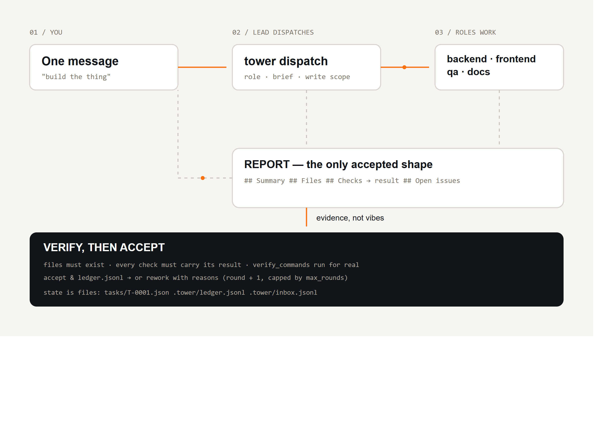
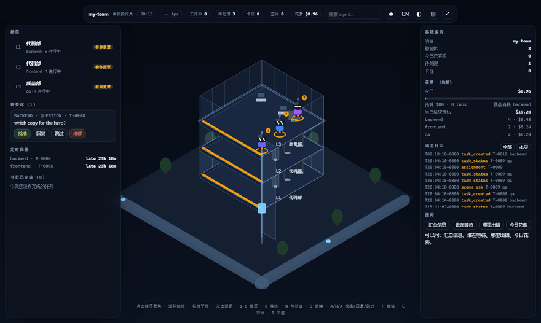
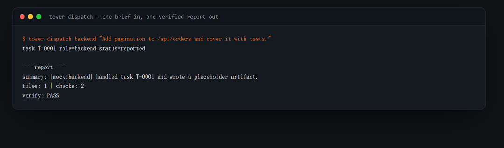
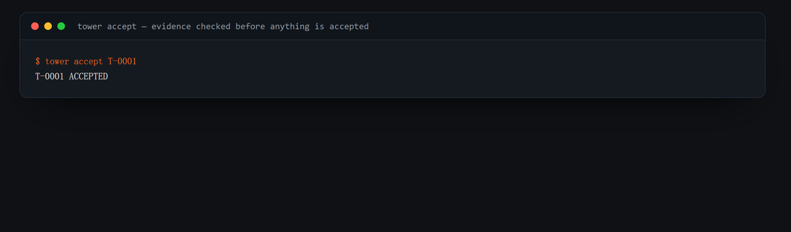
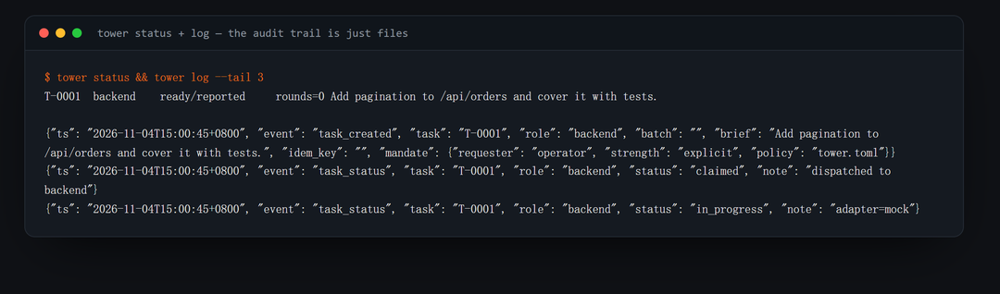
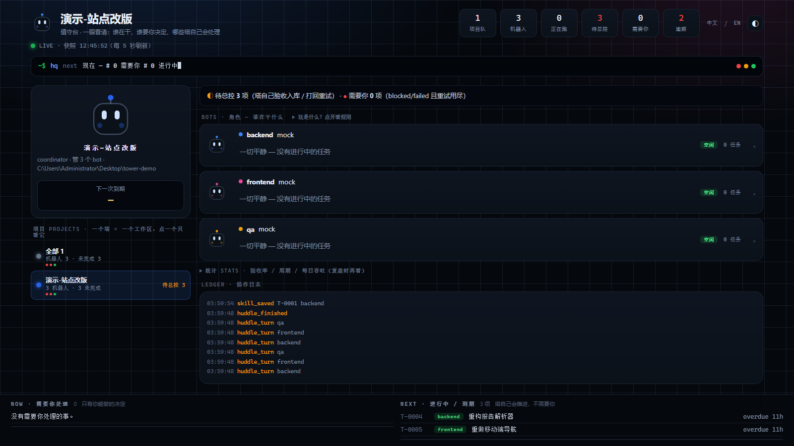

<div align="center">

# agent-control-tower

**你只跟一个 agent 说话；干活的是多个角色 agent；说"做完了"之前先过验证。**

面向角色制 AI agent 团队的本地控制塔 —— 派活、回执、校验、接受或打回。
DSH 优先，适配器可换，无 SaaS、无数据库、无守护进程。

[](README.zh.md) [](README.md)

[](pyproject.toml)
[](LICENSE)
[](tests)
[](https://github.com/evolution301/agent-control-tower/actions/workflows/ci.yml)
[](https://github.com/evolution301/agent-control-tower/releases)
[](packages/dsh-tower)

</div>




## 异步派单与中继（0.9.x）

```python
# DSH 插件
tower_dispatch { role, brief, async: true }     # <1s 返回任务号，worker 后台跑
tower_relay    { to, message, await_receipt: true }
```

```bash
# CLI
tower dispatch seo "..." --async          # 立即返回；后台 worker 跑 adapter + 自动分诊
tower worker --once                       # 手动清队列（一般不用，自动拉起）
tower relay --to <目标> -m "..." [--await-receipt] [--timeout 45m] [--wait 回执文件]
```

- `--to` 支持三种写法：**会话 id** / **`role:<角色名>`** / **标题唯一子串**；别名 `tower` = 本塔收件箱。
- 结算（自动验收/打回/升级）后写一条 `async_settled` 到 `tower inbox`；配置
  `notify.kind: lead_session` + `session:` 时还会推一条消息到 lead 会话。
- 回执：对方用 `tower relay --to tower --reply <R-id> -m "..."` 回话（或 `--wait <文件>`
  直接盯文件），`relay_receipt` / `relay_timeout` 落 inbox。

```yaml
# tower.toml
dispatch_mode: sync     # 默认 sync 完全兼容；async 全塔异步
workers: 4              # worker 线程池
async_roles: [seo, ops] # 角色级覆盖
notify:
  kind: lead_session
  session: session-…
```

### 上下文卫生（0.10.2）

`tower ctx` 打印各会话 contextPressure（≥50% 标 ⚠，John 规则：50% 必须压缩）；DSH 插件 `tower_compact { session }` 在宿主进程内直接调用压缩服务（等价原生 /compact，不多花一个 turn），支持 `role:<角色名>` 定位。

DSH 自带自动压缩（`@deepseek-ai/dsh-compaction-basic`，base 默认挂载）。阈值在 `compaction-basic.thresholdRatio`（默认 **0.8**）；在 cordis patch 里改成 **0.5** 即全局「50% 自动压缩」，无需任何插件：
```yaml
- id: compaction-basic
  config:
    thresholdRatio: 0.5
```
插件的 `tower_compact { session }` 保留为手动一键触发；`tower ctx` 照常打印各会话实时压力。

## 场景看板（0.8+）

`tower panel` 起来后访问 **`/scene`**：等轴测玻璃塔楼，每个角色一台机器人、每层一个部门、
楼层 LED 显示告警状态；批准 / 回复 / 跳过 / 维修直接在页面点（动作全部落台账）。
运营表格视图仍在 `/`，两页右上角互相跳转。每个数字的口径见
`docs/board-model.md`，中英切换 `?lang=zh|en`。

## 它解决什么问题

单个 agent 能写代码、能写文案、能审查。真正翻车的是**它们之间的交接**，而且翻得很有规律：

| 实际会发生的事 | 你要付的代价 |
|---|---|
| **自己给自己打分**：干活的 agent 顺便汇报"做完了、测试通过"，其实没跑 | 上线才发现 bug |
| **上下文腐烂**：长会话一压缩，交付物只存在"对话里" | 重复劳动、前后矛盾、无限循环 |
| **静默撞车**：两个 agent 同一轮改同一个文件，都报成功 | 丢改动、查不出原因的回归 |
| **没有审计**：哪个角色在什么指令下改了什么？ | 无法复核、无法复现、无法交接 |
| **乒乓**："改一下"→"改好了"→"还是不对" | 几小时白烧，你自己变成消息总线 |

`agent-control-tower` 就是缺的那层中间件。

## 闭环长什么样



| 派活 | 校验后接受 |
|---|---|
|  |  |

| 审计轨迹（就是文件） |
|---|
|  |

```bash
tower dispatch frontend "重做首页版式。交付 1440/390 前后截图和逐段说明。"
tower inbox                      # 角色交了什么都在这
tower accept T-0001              # 文件真的存在？checks 带结果？verify_commands 过？
tower rework T-0001 --note "Checks 没写结果，重跑测试"
```

## 适合谁用

**合适**

- 你已经在同时跑 **2–8 个 agent 会话**（DSH、Claude Code、Codex、Cursor、Aider、直接调 API），并且正在充当它们之间的人肉中转站
- **独立开发者 / 小团队**，在做多工种协作的项目：应用（后端 + 前端 + QA）、内容站（调研→文案→设计→SEO）、数据管道
- **乙方 / 外包 / 代运营**，需要向客户证明"做了什么、怎么验的"——ledger 和报告就是答案
- 被 agent 一句"done"坑过的人
- 想把 agent 工作放进 **CI / 自动化**：`tower demo` 可以离线 1 秒跑完整个闭环

**不合适**

- 一次性小任务（"把这个变量改名"）——直接一个 prompt 更快
- 你希望 agent 之间自由通信——这套是刻意设计的中心辐射结构
- 你想要托管面板 / 多租户服务——这是本地 CLI + 适配器

## 你会得到什么

| 没有这套 | 有了这套 |
|---|---|
| 你在多个窗口之间复制粘贴 brief | `tower dispatch <role> "<brief>"`，契约和写权限一起下发 |
| "Done ✅"，没有证据 | 报告必须写 **Files**（文件要真存在）和 **Checks**（每行要带结果）；`verify_commands` 真的会跑 |
| 交付物散落在聊天里 | 交付物在 `roles/<role>/`，报告是 `<task>-REPORT.md` |
| 没人知道谁改了什么 | 追加式 `.tower/ledger.jsonl`，带时间戳 |
| 轮次无限循环 | `round` 计数 + `max_rounds`，到头就停下让你升级人工 |
| 两个 agent 互相覆盖 | 每个角色一个 `write_scopes`，一个目录 |
| 上下文一压缩就丢活 | 状态落盘，`tower rework T-0012` 带着意见继续 |
| 项目没法交接 | 报告和任务的 `git log` 本身就是交接文档 |
| 每份回执都要你读一遍才知道要不要人插手 | `tower attention` 只列 `ready` / `blocked` / `failed` |
| 重试或双击产生重复任务 | `tower dispatch --key <id>` 直接返回已有任务 |

## 安装

```bash
git clone https://github.com/evolution301/agent-control-tower.git
cd agent-control-tower
python -m venv .venv && source .venv/bin/activate   # Windows: .venv\Scripts\activate
pip install -e .
```

Python 3.10+，运行时只依赖 `PyYAML`。

## 60 秒演示（不需要模型、不需要网络、不需要 Key）

```bash
tower demo
```

```
[1] dispatched T-0001 -> reported
[2] verify: PASS
[3] accepted T-0001
[4] ledger lines: 5
```

`mock` 适配器会写一个占位交付物和一份**格式正确**的报告，所以整条派活→回执→校验→接受链路是确定的、可进 CI 的。

## 用 DSH 跑（主推）

这套模式本来就是从一个真实的 [DeepSeek Harness](https://github.com/) 部署里抽出来的：一个 lead 会话带多个长期角色会话跑完多周项目，每个交付都先验证再接受。

```yaml
# tower.toml
roles:
  frontend:
    description: 版式、组件、样式、浏览器双端验证。
    adapter: dsh
    write_scopes: ["web/"]

adapters:
  dsh:
    base_url: "http://127.0.0.1:65163"
    sessions:
      frontend: "session-acc99990-..."
```

→ 完整步骤见 **[docs/dsh-quickstart.md](docs/dsh-quickstart.md)**（建角色会话、接配置、跑闭环，以及参考项目踩过的 5 个坑和代码里怎么防）。

### 在 DSH 会话里直接调用：`packages/dsh-tower`

配套插件在 harness 工具注册表里注册 5 个工具，会话不用离开对话窗口：

```bash
dsh plugin --profile <name> add ./packages/dsh-tower
```

`tower_dispatch` · `tower_inbox` · `tower_accept` · `tower_rework` · `tower_status`
→ [packages/dsh-tower](packages/dsh-tower/README.md)

## 面板：一眼看清谁在干什么

同一份快照的两种呈现 —— 终端 `tower board` 和本地只读网页 `tower panel`。**"等人"的排最前，健康状态不占地方。**



```bash
tower board            # 打印一次
tower board --watch    # 原地刷新（tmux/ssh 友好）
tower panel            # http://127.0.0.1:8787/  只读，2 秒自刷新
```

顺序固定：**需要你决定**（ready/blocked/failed，每个带那一个具体问题）→ **进行中** → **各角色此刻在做什么** → ledger 尾巴。
读的就是 CLI 读的那几个文件，没有数据库、没有守护进程、不写任何东西。

## 适配器

适配器是唯一知道"怎么让 agent 动起来"的组件。四个后端同一套契约：

| 适配器 | 驱动什么 | 什么时候用 |
|---|---|---|
| `dsh` | 活着的 DeepSeek Harness 会话（`session/prompt`，排队投递） | **主推**：带浏览器/终端工具的长会话 |
| `cli` | 任何吃 prompt 的 agent 二进制（`claude -p`、`codex exec`、Aider、你自己的脚本） | 你本来就在用 agent CLI |
| `openai` | 任何 OpenAI 兼容 `/chat/completions`，配一个极小的 `run_shell` 循环 | 托管模型、vLLM、Ollama |
| `mock` | 什么也不驱动，只写占位交付物 | 测试、演示、CI |

自己加一个大约 40 行 → [docs/adapters.md](docs/adapters.md)。

## 回执契约（以及为什么必须有校验器）

```markdown
## Status         → progress | waiting | ready | blocked | failed | dropped
## Summary        → 2–5 句话
## Files          → - <路径> — <改了什么>            （文件必须真实存在）
## Checks         → - <实际跑的命令> → <实际看到的结果>  （只写命令 = 不合格）
## Open issues    → 没做完的，或 "none"
## Attention      → 仅当 Status 是 blocked/failed：一个具体问题
```

状态是一套封闭词表，来自 DeepSeek 的 [dsh-superagent](https://github.com/deepseek-ai/dsh-superagent-prototype) 研究原型：
lead 按状态路由而不是读散文，`tower attention` 只显示真的在等人的任务。我们抄了什么、刻意没抄什么，见
[docs/superagent-ideas.md](docs/superagent-ideas.md)。

`tower accept` 会机械地拒掉：缺章节 · check 没带结果 · 报告里的文件不存在 · `verify_commands` 任何一条失败。

```yaml
verify_commands:
  - "pytest -q"
  - "npm run build"
```

这就是"agent 说它能跑"和"控制塔验过了"的区别。

## 命令

| 命令 | 作用 |
|---|---|
| `tower init <dir>` | 生成配置和角色目录 |
| `tower dispatch <role> "<brief>" [--due 90m]` | 建任务并执行（`--key` 幂等，`--due` 给期限） |
| `tower dispatch <role> "<brief>" --restate` | 复述确认：角色先用自己的话复述 brief，不派活 |
| `tower restate ok <task>` | 接受复述，这时才真正派活 |
| `tower say <谁> <对谁> "…"` | bot 对 bot 留言：同时投进对方会话 + 归档给总控，发完即走不等回 |
| `tower huddle 角色1 角色2 … --topic "…"` | 最多六个角色进房讨论，两轮为限；纪要落在 `.tower/huddles/` |
| `tower supervise` | 到期未交的任务，总控进它的会话逐个催办 |
| `tower batch role1 role2 --brief "…"` | 同一 brief 分发给多个角色 |
| `tower inbox [--all] [--read]` | 角色提交的全部回执（审计日志） |
| `tower attention` | **只**列出在等人的任务 |
| `tower board [--watch]` / `tower panel` | 同一画面：终端面板 / 本地网页 |
| `tower accept <task>` | 校验后接受（校验不过自动转打回） |
| `tower rework <task> --note "…"` | 带意见打回并重派 |
| `tower status [--json]` | 任务看板 |
| `tower show <task>` / `tower log` | 看单个任务 / 跟 ledger |
| `tower demo` | 离线全链路演示 |
| `tower doctor` | 检查配置、适配器、Key、会话 |

`--restate` 是用一次便宜的调用换掉一次昂贵的调用。角色只回 `## Restatement` / `## Assumptions` /
`## Done looks like` 三段，任务停在 `restating`、出现在 **needs you** 里、而且**不能**被 accept
（此时还没有回执）。`tower restate ok <task>` 把这段复述以 `## Confirmed understanding` 写进正式派活的
提示词，然后才派活。这个关口是失败关闭的：适配器报错或缺这段，任务进 `failed`，绝不会进 `restating`。

## 磁盘上有什么

```
my-project/
├── tower.toml              # 角色、适配器、验证命令
├── roles/
│   ├── backend/            # 这个角色唯一可写目录
│   │   ├── AGENT.md
│   │   └── T-0001-REPORT.md
│   ├── frontend/
│   └── qa/
└── .tower/
    ├── tasks/T-0001.json   # 任务物化视图
    ├── ledger.jsonl        # 追加式事件日志（事实来源）
    └── inbox.jsonl         # 回执 + 未读标记
```

## 和别的方案比

|  | 单 agent | agent 框架（图/DSL） | **agent-control-tower** |
|---|---|---|---|
| 谁来路由任务 | 那个 agent 自己脑子里 | 你写的图 | lead 显式地按任务路由 |
| 交付物 | 聊天文本 | 节点输出 | 文件 + 四段式报告 |
| "完成"的定义 | agent 说的 | 节点跑完了 | 控制塔验过了 |
| 审计轨迹 | 滚动聊天记录 | 框架日志 | 可以 `git diff` 的 `ledger.jsonl` |
| 上手成本 | 一个 prompt | 图 + 运行时 + 基建 | `pip install` + 一个 YAML |
| 能离线/进 CI | 不能 | 有时可以 | 能（`tower demo`） |

## 常见问题

**必须用 DSH 吗？** 不。DSH 是主适配器，因为模式来自那里；`cli`、`openai`、`mock` 用同一套契约。

**它会自己跑 agent 吗？** 不会。它渲染 prompt、调你的适配器、校验回来的东西。运行时还是你的。

**agent 之间能互相通信吗？** 不能。中心辐射是刻意的：只有 lead 路由，任务树才可审计，两个角色也不会悄悄改同一个文件。

**角色一直失败怎么办？** 每次 `rework` 都 `round + 1`；超过 `max_rounds` 控制塔会停下并提示升级人工，而不是继续循环。

**ledger 能提交进 git 吗？** 能，追加式 JSONL；提交它等于把审计轨迹放进 `git log`。只想要交付物就 `.tower/` 加进 `.gitignore`。

**它会往哪写？** 只在工作区内：交付物在 `roles/<role>/`，状态在 `.tower/`。

## 文档

| 文档 | 内容 |
|---|---|
| [DSH 快速开始](docs/dsh-quickstart.md) | 主推配置的完整步骤 + 它能避免的 5 个失败模式 |
| [架构](docs/architecture.md) | 组件、状态机、为什么用文件而不是队列 |
| [适配器](docs/adapters.md) | mock / cli / dsh / openai，以及怎么加自己的 |
| [从 dsh-superagent 抄了什么](docs/superagent-ideas.md) | 吸收的 5 个设计 + 刻意没抄的 |
| [贡献指南](CONTRIBUTING.md) | 硬规则、PR 检查清单、适配器写法 |

## 许可

MIT —— 见 [LICENSE](LICENSE)。

## 说明

- 模式来自一个真实的 DeepSeek Harness 长期项目，之后抽象成不依赖 harness 也能跑的实现。
- `dsh-tower` 插件遵循 [DeepSeek Harness 文档](https://github.com/deepseek-ai/deepseek-harness) 的 bundle 约定：`dsh.bundle` + `cordis.patch.yml` + `ctx.tools.register`。
- README 里的终端截图是**真实命令输出**，由 [`docs/assets/build_assets.py`](docs/assets/build_assets.py) 生成，不是设计稿。

## Star History

[](https://star-history.com/#evolution301/agent-control-tower&Date)
